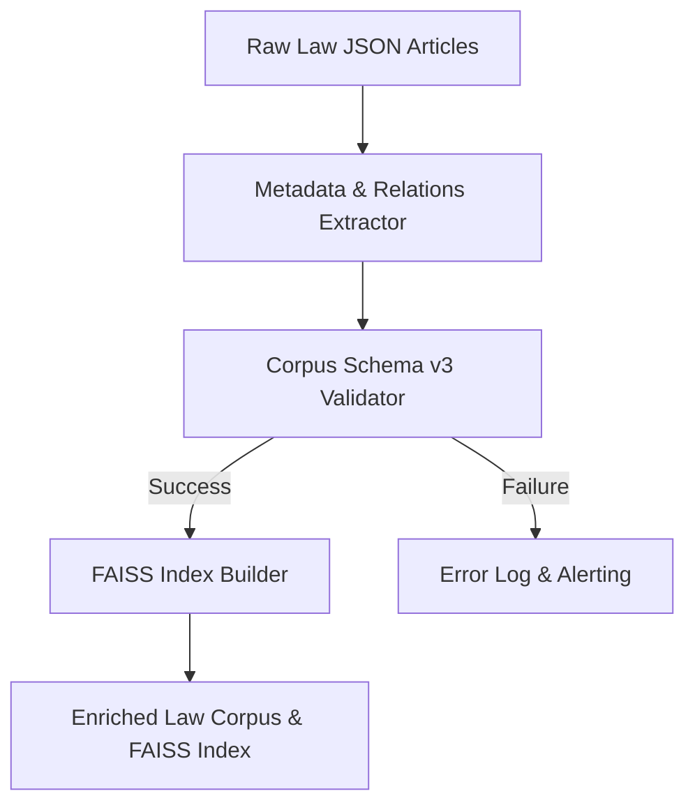

# Metadata Enrichment Pipeline Design

> **Status:** DESIGN / PLANNED ONLY — not the current runtime implementation.
> **Source of truth:** CODE > TEST > CONFIG > DOCUMENTATION > README > COMMENT > ASSUMPTION.

This document details the architecture, workflows, and leakage controls of the LLM-based Metadata Enrichment Pipeline (Phase 3).

---

## 1. Pipeline Architecture & Workflow

The enrichment pipeline processes legal text documents to extract structured metadata, relations, and semantic tags using Gemini models.

### Key Workflow Stages:
1. **Extraction**: Calls the LLM to analyze the title, chapter title, and text content of each law article to identify:
   - Historical context (amendments, repeals).
   - Cross-references to other articles or codes.
   - Conceptual domain tags (e.g., mortgage, dispute, contract).
2. **Validation**: Enforces schema validation against `corpus_schema_v3.json`.
3. **Indexing**: Generates new vector embeddings for the enriched text structure (which combines title, summary, and conceptual keywords) to feed the FAISS index.

---

## 2. Target Files

* **New Pipeline Script**: `backend/scripts/Evaluation/enrich_corpus.py`
* **Modified Files**:
  * `backend/app/services/search_service.py` (updated to load and search enriched properties)
  * `backend/app/services/llm_service.py` (updated context generation using structured metadata)

---

## 3. Leakage Control Mechanisms

To prevent ground truth leakage into the model prompts or indexes (which artificially inflates evaluation metrics), the pipeline enforces strict boundary controls:

### Prompts Sanitization
* During LLM-based enrichment, raw query texts and user judgment benchmark cases in `judgments_evaluation.json` are completely segregated. The LLM only receives context from standard statutory law texts (`standardized_*.json`), preventing the model from associating laws with specific benchmark queries.

### Vector Search Sandboxing
* The index is generated exclusively from the statutory text. No query text or judgment-specific metadata is embedded in the FAISS index.
* During evaluation runtime, search queries are normalized and cleaned of explicit citations prior to matching vector representations.

---

## 4. Evaluation Plan

### Expected Metric Impact
* **WeightedRecall**: +4% (owing to rich conceptual keywords in search text).
* **nDCG**: +5% (due to field-weighted BM25 indexing over summary and tags).
* **Semantic Drift Reduction**: Decreased failure counts under "semantic drift" taxonomies by 15% through matching high-quality conceptual tags.

---

## 5. Acceptance Gates

### P3-G2 Enrichment Pipeline
* **PASS Criteria**: Pipeline runs end-to-end over all statutory articles without failures, producing populated `summary`, `keywords`, and `tags` keys.
* **FAIL Criteria**: Any LLM call fails, or values are null or empty.
* **Required Evidence**: Execution log displaying success and a verification check counting zero empty fields.

### P3-G3 Leakage Control
* **PASS Criteria**: Assert that zero text from `judgments_evaluation.json` queries or labels is present in the database law index text fields.
* **FAIL Criteria**: A leak is detected (similarity score of 1.0 between raw query segments and corpus tags).
* **Required Evidence**: Automated leakage audit script output log showing `0 leaks found`.
